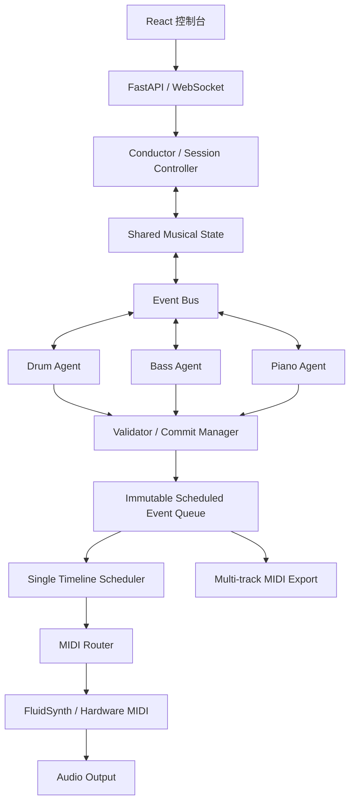

# Multi-Agent Band — 开发设计文档

> 版本：v0.1 | 日期：2026-11-20 | 状态：技术方案 / MVP 规划

## 1. 项目定位

开发一个多智能体虚拟乐队系统。每个乐器 Agent 独立决定自己的演奏策略，能够感知共享音乐上下文和其他乐手的提案；统一的音乐时间系统负责可靠同步，MIDI 引擎负责演奏和文件导出。

**核心原则：Agent 决定演奏什么；Scheduler 决定什么时候演奏；Synthesizer 决定听起来如何。**

### 1.1 首版 MVP

- 三个 Agent：Drums、Bass、Piano（爵士三重奏，仅作测试配置，可换风格）。
- 4/4、固定 BPM（默认 120）、固定 8 小节循环和弦进行；后续加入速度图与变拍号。
- 每个 Agent 提前提交未来 2 小节的 MIDI 片段。
- 统一调度器播放、暂停、停止、循环，并导出三轨 MIDI。
- 用户可修改音量、乐器开关、演奏密度、BPM 和和声（改变在约定小节边界生效）。
- 有明确的异常恢复策略：Agent 超时、事件重复、状态失效不能卡住全局时钟。

### 1.2 非目标（首版不做）

- 毫秒级 LLM 逐音符决策；
- 分布式跨设备实时同步；
- 复杂 VST 宿主、专业 DAW 级混音；
- 多模态听觉反馈与音频识别；
- 强化学习训练或多 Agent 自然语言自由协商作为必要依赖。

## 2. 系统总览



### 2.1 组件职责

| 组件 | 职责 | 是否允许阻塞播放线程 |
|---|---|---|
| Session Controller | 播放状态、乐队配置、曲式与和弦 | 否 |
| Agent Runtime | 感知、计划、生成未来片段 | 可异步耗时 |
| Shared State | 当前歌曲、节拍、小节、版本信息 | 否 |
| Event Bus | 发布订阅、提案和反馈 | 不允许阻塞调度器 |
| Validator | 音符范围、事件长度、状态版本、重复检查 | 在提交阶段执行 |
| Commit Manager | 原子提交小节/片段；锁定未来即将播放区域 | 否 |
| Scheduler | 将节拍时间转为单调时钟时间并执行事件 | **绝不调用 LLM 或网络** |
| MIDI Router | 将轨道映射到合成器或物理端口 | 否 |
| Exporter | 保存多轨 MIDI 和会话记录 | 可在后台任务执行 |

## 3. 技术栈

### 3.1 首选

- **Python 3.12+**：核心服务和音乐逻辑。
- **asyncio**：Agent 并发任务；只用于业务协调，不作为硬实时音符计时器。
- **Pydantic v2**：控制消息、乐器计划、音符事件模型。
- **FastAPI + WebSocket**：控制 API 和可视化状态推送。
- **Mido + python-rtmidi**：MIDI 消息、外部设备、MIDI 端口。
- **FluidSynth（libfluidsynth）**：通过 SoundFont (.sf2) 合成音频；Python 可用 pyfluidsynth 绑定。
- **pretty_midi**：MIDI 文件处理与导出；复杂 tempo map 导出时需明确核查事件时序。
- **SQLite**：乐队/乐器配置、会话快照、事件日志；MVP 用文件存储也可。
- **React + TypeScript + Vite**：控制面板，Piano Roll 用 Canvas 或 SVG 实现。
- **pytest、Ruff、mypy（可选）**：测试、静态检查。

### 3.2 可选与后续升级

- **LLM Provider SDK / LiteLLM**：模型路由，可切换云端和本地 LLM。
- **music21**：复杂和声分析与符号音乐处理；首版也可自写最小和弦映射。
- **MCP Python SDK**：向外部 AI 客户端提供乐队控制工具；不是内部实时通信总线。
- **NATS**：进程/主机间 Agent 事件总线；单机 MVP 使用 asyncio.Queue 更简单。
- **Rust/C++**：后续实现更低抖动的调度执行器与音频回调；调度优化前应先测量性能。
- **Ableton Link**：多应用/设备的节拍、速度和相位同步；不传输乐器 MIDI 音符，也不替代 Agent 协议。

### 3.3 工程约束

- 所有 Agent 输出均是**意图/计划/音符数据**，不直接写 MIDI 端口。
- 音符使用 `beat` 时间单位（建议整数 tick 或 Fraction；MVP 可用受控分辨率 960 PPQ），避免 float 累积误差。
- 音轨标识和乐器状态不能直接与 MIDI channel 混同；鼓组常用 GM channel 10（程序内部 0-based 9）。
- 所有 MIDI note_on 必须有配对的 note_off；停止/异常退出时发送 All Notes Off / All Sound Off，必要时维护活跃音符表。
- SoundFont 音色库许可需单独审核；不要默认任何 `.sf2` 都可自由分发。

## 4. 关键数据结构

### 4.1 Song / Session 状态

```json
{
  "session_id": "session-001",
  "state_version": 42,
  "transport": "playing",
  "bpm": 120,
  "meter": {"numerator": 4, "denominator": 4},
  "ticks_per_beat": 960,
  "current_bar": 8,
  "chord_progression": ["Dm7", "G7", "Cmaj7", "Cmaj7"],
  "section": "A",
  "mood": "relaxed",
  "intensity": 0.5
}
```

BPM 和拍号变化只允许通过控制事件在约定边界提交；调度器不得读取会被其他线程原地修改的 tempo map。

### 4.2 统一 NoteEvent 模型

```json
{
  "event_id": "bass-12-0001",
  "track_id": "bass",
  "bar": 12,
  "start_tick": 0,
  "duration_ticks": 720,
  "pitch": 45,
  "velocity": 98,
  "channel": 1
}
```

约束：`pitch` 和 `velocity` 在 MIDI 0–127 范围；`duration_ticks > 0`；`start_tick >= 0`；MVP 可以规定音符不得跨小节，升级后允许跨小节但由统一调度器管理 note_off。

### 4.3 Agent 提交

```json
{
  "agent_id": "bass_01",
  "target_bar": 12,
  "revision": 3,
  "based_on_state_version": 42,
  "intent": "lock_with_kick",
  "notes": [
    {"track_id": "bass", "bar": 12, "start_tick": 0,
     "duration_ticks": 720, "pitch": 45, "velocity": 98, "channel": 1,
     "event_id": "bass-12-0001"}
  ]
}
```

Commit Manager 必须检验：目标小节尚未锁定、状态版本兼容、事件 ID 不重复、乐器音域和音符数量满足上限。成功则原子替换指定 Agent 的未锁定片段；失败则返回明确错误。

### 4.4 乐手协商消息

```json
{
  "message_id": "proposal-001",
  "from_agent": "drum_01",
  "to_agents": ["bass_01", "piano_01"],
  "type": "intensity_proposal",
  "effective_bar": 16,
  "payload": {"target_intensity": 0.8},
  "expires_at_bar": 15
}
```

协商有截止时间。若未响应，保持现有演奏方案；不阻塞 scheduler。

## 5. 时间与同步系统

### 5.1 时间表示

采用 **音乐时钟 + 系统单调时钟** 双层模型：

1. 业务层以 bar / beat / tick 表示音乐位置。
2. `TempoMap` 将音乐位置转为目标播放时间。
3. Scheduler 使用 `time.perf_counter_ns()` / 等价单调时钟调度发送；不得使用系统墙上时钟 `time.time()`。
4. 速度发生变化时，只允许重新计算尚未锁定的事件时刻。

恒定 BPM、四分音符为一拍时：

`seconds_per_beat = 60 / BPM`

一般时签与 tempo map 必须实现独立转换接口，不能将所有拍号硬编码为 4/4。

### 5.2 Look-ahead（提前排程）

- 默认 Agent 规划 horizon：未来 2 小节。
- 当前小节始终来自已提交队列。
- 设定锁定窗口（例如当前播放位置前 1 拍，具体依据测量调节）。
- Agent 只能更新未锁定区域。
- 如果 Agent 未按时完成：复用上一次稳定模式，或使用确定性规则兜底；兜底也要符合和声状态。
- 不允许因 Agent 生成超时暂停全局节拍。

### 5.3 取消、停止与故障处理

- Stop：阻止新 note_on、发出所有活跃 note_off，重置 transport。
- Pause：定义持续音处理策略；MVP 推荐发送 all-notes-off，resume 从边界重新排程。
- Track mute：停止该轨道新事件并释放其活跃音符。
- Tempo change：按提交边界原子生效。
- 重连或进程重启：明确清空事件队列和设备状态；不要假设 MIDI 设备会自行结束挂起音符。

## 6. 乐器 Agent 设计

统一抽象接口：

```python
class InstrumentAgent:
    async def perceive(self, snapshot): ...
    async def plan(self, context, target_bars): ...
    async def generate(self, plan): ...
    async def evaluate(self, proposal): ...
    async def on_message(self, message): ...
```

### 6.1 Drum Agent

- 输入：BPM、风格、强度、曲式、其他乐器的节奏密度。
- 输出：kick/snare/hi-hat 的 MIDI drum notes。
- MVP：固定模板 + velocity variations + fill 的可控随机化。
- 后续：生成 groove、保留 swing、响应 Bass 提案。

### 6.2 Bass Agent

- 输入：当前和弦、kick 时间点、和声目标、演奏音域。
- 输出：根音、五音、经过音、切分或 walking bass。
- MVP：根据和弦根音与 kick 位置生成稳定 bass line。
- 后续：motif 和记忆、即兴、跨小节连接。

### 6.3 Piano Agent

- 输入：和弦进行、Bass 音区、风格、乐队密度。
- 输出：voicing / comping / 简单 melodic fill。
- MVP：三/七音构成简化 voicing，控制节奏和音域。
- 后续：voice leading、和声张力、主旋律交互。

### 6.4 Conductor Agent

- 控制全局段落、BPM 目标、演奏强度与和声边界。
- 不直接逐音符支配其他 Agent。
- LLM 输出高层结构化计划，由规则引擎验证后提交。

### 6.5 智能程度分级

- L0 确定性规则 Agent：复现、回归测试。
- L1 参数化/概率策略 Agent：密度、变奏、种子可控。
- L2 LLM 策略 Agent：只生成未来几小节的风格和动机计划。
- L3 学习型 Agent：音乐生成模型、反馈学习、多 Agent 协商。

## 7. 后端 API（草案）

| Method | Endpoint | 作用 |
|---|---|---|
| POST | `/sessions` | 创建会话 |
| POST | `/sessions/{id}/play` | 播放 |
| POST | `/sessions/{id}/pause` | 暂停 |
| POST | `/sessions/{id}/stop` | 停止 |
| PATCH | `/sessions/{id}/settings` | 更新 BPM、风格、强度等 |
| PATCH | `/sessions/{id}/tracks/{track}` | 静音、音色和音量 |
| GET | `/sessions/{id}/state` | 当前乐队状态 |
| GET | `/sessions/{id}/export.mid` | 导出多轨 MIDI |
| WS | `/sessions/{id}/events` | 推送运输状态、Agent 决策、演奏事件 |

WebSocket 事件必须带 `sequence` 或时间戳；前端不是权威节拍源，断线后通过状态快照恢复。

## 8. 目录结构

```text
multi-agent-band/
├── pyproject.toml
├── README.md
├── DEVELOPMENT.md
├── config/
│   ├── default.yaml
│   └── instruments.yaml
├── backend/
│   └── band/
│       ├── api/                 # FastAPI endpoints / websocket
│       ├── agents/              # base, conductor, drum, bass, piano
│       ├── music/               # harmony, rhythm, voicing, motifs
│       ├── runtime/             # coordinator, shared_state, event_bus
│       ├── timing/              # transport, tempo_map, scheduler
│       ├── midi/                # event types, router, exporter
│       ├── audio/               # fluidsynth adapter
│       ├── persistence/         # sessions/events/config
│       └── schemas/             # pydantic models
├── frontend/
│   ├── src/components/
│   ├── src/pages/
│   └── src/lib/
├── soundfonts/                 # ignored; provide download instructions
├── tests/
│   ├── unit/
│   ├── integration/
│   └── performance/
└── scripts/
    ├── run_demo.py
    └── export_demo.py
```

## 9. 开发任务与里程碑

### M0 — 工程初始化

- [x] `uv` 或 `venv` 建立 Python 环境，初始化 `pyproject.toml`。
- [x] 配置 Ruff、pytest、日志、CI。
- [x] 确认目标操作系统的 FluidSynth 安装和音频驱动。
- [x] 导入具有明确授权的 `.sf2` 音色库。
- **验收**：命令行能播放 C 大三和弦并正常关闭，不出现挂音。

### M1 — MIDI 内核（无 AI）

- [x] 定义 NoteEvent、Track、Session、TempoMap。
- [x] 实现 tick -> 时间转换、scheduler、note_off 管理。
- [x] 实现三轨 MIDI 路由和多轨导出。
- [x] 实现 fake clock 测试，不依赖真实音频设备。
- **验收**：三轨同时正确播放，所有 note_on 都有 note_off，导出 MIDI 可在 DAW 打开。

### M2 — 三个规则 Agent

- [x] Drum 生成鼓型；Bass 根据和弦与 kick 生成低音；Piano 根据和弦生成伴奏。
- [x] Shared State + Event Bus + validator + atomic commit（无独立消息总线：提案经 `BarContext` 依次传递，协商消息与调度器事件日志承担事件流）。
- [x] 2 小节提前生成、locked window、超时 fallback。
- [x] 使用种子控制可复现随机结果。
- **验收**：无 LLM 情况下连续演奏 10 分钟；人为延迟某 Agent 不影响其他 Agent 的时钟。

### M3 — 控制 API 与前端

- [x] FastAPI 控制 endpoints、WebSocket 事件流。
- [x] React 轨道状态、Transport 按钮、Piano Roll、和弦进度显示。
- [x] 支持 mute、BPM、密度等参数更改；明确生效小节。
- **验收**：浏览器能开始/停止、独立静音轨道，并查看计划与实际执行事件。

### M4 — LLM 指挥与乐器策略

- [x] 定义经过 Pydantic 验证的 ConductorPlan。
- [x] LLM 为每个 Agent 生成演奏意图，而不是直接操作 MIDI 输出。
- [x] 限流、超时、重试和规则 fallback。
- [x] 记录模型版本、提示词版本与规划输出以利复现。
- **验收**：自然语言改变风格/强度后，变化在未来指定小节出现；断网仍能持续演奏。

### M5 — 多 Agent 协商

- [x] Proposal / Response / Timeout 协议。
- [x] Drum-Bass 节奏联动、Piano 对密度变化的响应。
- [x] 冲突仲裁：全局时钟和和弦属于权威状态，局部演奏可自主调整。
- [x] 设计消融实验：无协作、只有共享状态、显式协商三组对照。
- **验收**：可观测到 Agent 自主提案与他者响应，且协商超时不影响播放。

### M6 — 高级功能（按需）

- [x] 用户 MIDI 输入参与即兴；
- [ ] 更先进的音乐生成模型；
- [x] OSC/VST 或 SuperCollider 音色系统（SuperCollider 经本地 OSC；不含 VST 宿主）；
- [x] 更低抖动的 Rust/C++ scheduler（以 C 原生计时实现最后一段绝对等待与线程实时优先级，调度逻辑仍在 Python）；
- [x] Ableton Link 与分布式 Agent（Link 共享速度、小节相位与启停；远程进程经 WebSocket 接管单轨，超时按小节兜底）。

## 10. 测试计划

### 单元测试

- tick 时间与 bar/beat/tick 的互转（含边界、拍号变化）；
- NOTE 范围检查、跨小节音符与 channel 冲突；
- deterministic pattern 在固定 seed 下可复现；
- 乐器音域和和弦音匹配规则；
- 锁定区域拒绝过期修订；状态版本不匹配拒绝提交。

### 集成测试

- 10 分钟持续播放，不挂音、不重复释放；
- Agent 故意延迟或异常退出，其他乐手继续播放；
- 运行中修改 BPM / mute / 和弦，按约定边界生效；
- 导出的 MIDI 文件可由标准 MIDI 播放器和 DAW 读取。

### 性能指标

初始建议以指标为观测目标，不预设保证：

- 事件发送时间误差：记录 p50、p95、p99 与最大值，按操作系统/音频驱动分开测量。
- 计划及时提交率：按 target_bar 截止时间统计。
- Fallback 比例：逐 Agent 统计。
- 发音/释放配对正确率：目标 100%。
- 丢弃的迟到事件、重复事件和状态冲突次数。
- 播放进程内存、CPU 占用及音频 xrun 指标（如可获得）。

## 11. 具体实施顺序（首周可操作步骤）

1. 安装 Python 3.12+、FluidSynth、Mido/RtMidi，准备合法 `.sf2`；先写 `scripts/run_demo.py` 播放单个音。
2. 设计 `schemas/note_event.py` 与 `timing/tempo_map.py`；写 tick -> time 的单元测试。
3. 实现单个 Scheduler（含 priority queue、取消、note_off）；用 fake MIDI sink 验证顺序。
4. 实现 FluidSynthAdapter 和 MidiFileExporter；在没有 Agent 的情况下能生成并播放三轨演示。
5. 写三个确定性 Agent：鼓组 1 小节 pattern、贝斯根音/五音、钢琴和弦。
6. 接入 Shared State、两小节 ahead buffer、validator 和 atomic commit。
7. 增加 FastAPI 基础控制接口；前端可后置，命令行先跑通。

### 推荐的最小依赖

```bash
python -m venv .venv
# 激活虚拟环境后：
python -m pip install fastapi uvicorn pydantic mido python-rtmidi pretty_midi pyfluidsynth pytest ruff
```

> 注意：`pyfluidsynth` 还需要系统层安装 `libfluidsynth`；音频驱动设置依 OS 而异。不要在未安装动态库时把 Python 包安装成功误认为合成器可用。

## 12. 研究扩展与评估

研究主题：局部信息和自主目标下的多智能体音乐协同。

- A 组：所有乐手使用同一固定规则、无协商。
- B 组：各乐手独立生成，读取共享音乐状态。
- C 组：允许 Agent 发出提案、回应和记忆协作结果。

评价建议：节奏偏移、和声冲突、音域/频段占用代理指标、动机重复与变化、主观听评（盲测），同时记录 LLM 成本与实时延迟。避免将简单和声规则得分等同于音乐审美质量。

## 13. 已知风险与对策

| 风险 | 对策 |
|---|---|
| LLM 推理不稳定 | 提前规划，deadline + deterministic fallback |
| MIDI 挂音 | 活跃音符表 + note_off + all sound off |
| Agent 相互冲突 | 权威状态、锁定窗口和提交仲裁 |
| Python 时间抖动 | 单一 scheduler + 测量，必要时迁移 Rust/C++ |
| 速度变化引起错拍 | TempoMap 版本化，边界原子提交 |
| SoundFont 授权不明确 | 仓库不提交未经确认的音色文件 |
| MIDI 音轨/通道竞争 | 独立轨道状态、显式 channel 分配和 drum routing |
| 不同 OS 音频设备差异 | 抽象 MidiSink / SynthAdapter，支持 fake sink 测试 |

## 14. 主要项目与参考资料

- FluidSynth: https://github.com/FluidSynth/fluidsynth
- FluidSynth API: https://www.fluidsynth.org/api/Introduction.html
- Mido: https://github.com/mido/mido
- RtMidi backend: https://mido.github.io/mido/backends/rtmidi.html
- pretty_midi: https://github.com/craffel/pretty-midi
- Ableton Link: https://github.com/Ableton/link
- FastAPI: https://fastapi.tiangolo.com/
- MCP Python SDK: https://github.com/modelcontextprotocol/python-sdk

## 15. 定义完成（Definition of Done）

首版 MVP 被认为完成，当且仅当：

1. 三个独立的乐器 Agent 通过统一调度器连续演奏至少 10 分钟；
2. 能通过命令行/API 修改乐器开关、BPM、强度，并明确何时生效；
3. Agent 延迟或失败不会阻塞全局播放；
4. 可以导出三轨 MIDI 并在通用 DAW 中重新打开；
5. 所有关键时序与协议组件有自动化测试；
6. 能输出可分析的日志，包含计划小节、提交时间、实际发送时间、fallback 与异常。
